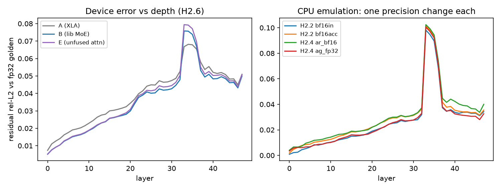

# Final tables and figures

Generated by `tools/make_figures.py` from `results/phase1/ledger.jsonl` and the reports under `results/phase1/`; TKG p50/p99 in ms, mean ± std over separate-process runs.

## 1. Latency vs sequence length

| config | seq | n | p50_mean | p50_std | p99_mean | p99_std |
|---|---|---|---|---|---|---|
| A | 768 | 5 | 15.116 | 0.02735 | 15.665 | 0.0414 |
| B | 768 | 5 | 10.522 | 0.03005 | 11.292 | 0.09985 |
| B | 2048 | 3 | 10.922 | 0.002119 | 11.394 | 0.03853 |
| B | 4096 | 3 | 11.206 | 0.09472 | 11.817 | 0.1595 |
| B | 8192 | 2 | 11.398 | 0.004552 | 11.932 | 0.0204 |
| C | 768 | 5 | 10.238 | 0.01626 | 10.777 | 0.05664 |
| C | 2048 | 3 | 10.388 | 0.05243 | 10.901 | 0.08926 |
| C | 4096 | 3 | 10.468 | 0.09304 | 10.962 | 0.2275 |
| E | 768 | 5 | 12.183 | 0.0218 | 12.654 | 0.07377 |
| Eh | 768 | 5 | 10.632 | 0.01827 | 11.084 | 0.02523 |
| Eh | 2048 | 3 | 10.726 | 0.06864 | 11.323 | 0.2873 |
| Eh | 4096 | 3 | 10.725 | 0.03774 | 11.230 | 0.1288 |
| V | 768 | 5 | 10.052 | 0.04146 | 10.574 | 0.1938 |
| V | 2048 | 3 | 10.194 | 0.216 | 10.676 | 0.3101 |
| V | 4096 | 3 | 10.172 | 0.01567 | 10.548 | 0.05568 |
| V | 8192 | 2 | 10.313 | 0.005563 | 10.631 | 0.06373 |

Ledger ids: `fig1_latency.csv`.

## 2. Where C's gain over B comes from (768)

| step | what | delta_ms | two_pooled_std |
|---|---|---|---|
| B -> E | unfused attention kernel (+ call cost) | 1.661 | 0.0525 |
| E -> Eh | per-call setup hoisted | -1.551 | 0.04023 |
| Eh -> C | fusion (call boundary, MoE kernel) | -0.3947 | 0.03459 |
| C -> V | collectives (AG + local sum) | -0.1853 | 0.06297 |
| B -> C (total) | C's gain over B | -0.2847 | 0.04831 |

## 3. Accuracy vs fp32 golden (frozen validator v1.1, 7,264 positions)

| config | v1.1 | rho_attn | rho_moe | rho_resid | router_flip_pct | kl_mean | kl_ratio_vs_xla | top1_golden | ppl | gross | run_to_run |
|---|---|---|---|---|---|---|---|---|---|---|---|
| XLA | PASS | 1.000 | 1.000 | 1.000 | 9.515 | 0.002258 | 0.9991 | 0.986 | 8.393 | 0 | bit_identical |
| B (lib MoE) | PASS | 0.9067 | 0.9091 | 0.9006 | 8.114 | 0.001967 | 0.8706 | 0.9868 | 8.379 | 0 | bit_identical |
| E (unfused attn) | PASS | 0.9267 | 0.9295 | 0.9388 | 8.241 | 0.002185 | 0.967 | 0.9865 | 8.397 | 0 | bit_identical |
| Eh (E, hoisted setup) | PASS | – | – | – | – | 0.002185 | 0.967 | 0.9865 | 8.397 | 0 | bit_identical |
| C (megakernel) | PASS | – | – | – | – | 0.002172 | 0.9613 | 0.9873 | 8.385 | 0 | bit_identical |
| V (C + AG collectives) | PASS | – | – | – | – | 0.002168 | 0.9596 | 0.9873 | 8.384 | 0 | bit_identical |

ρ and router flips need a capture build (none for C, V; Eh is bit-identical to E). Sources in the CSV.

## 4. Error vs depth and precision effects

| study | variant | kl_mean | kl_max | top1_golden | resid_L47 |
|---|---|---|---|---|---|
| H2.2 expert GEMMs | fp32 | 3.003e-06 | 0.004731 | 1.000 | 0.004607 |
| H2.2 expert GEMMs | bf16in | 0.0006846 | 0.1691 | 0.9937 | 0.03431 |
| H2.2 expert GEMMs | bf16acc | 0.0009865 | 0.1664 | 0.9924 | 0.03549 |
| H2.4 TP all-reduce | fp32 | 1.833e-06 | 0.004731 | 0.9999 | 0.004079 |
| H2.4 TP all-reduce | ar_bf16 | 0.0009249 | 0.8883 | 0.9934 | 0.04 |
| H2.4 TP all-reduce | ag_fp32 | 0.0006485 | 0.1619 | 0.9942 | 0.03261 |

## 5. Per-layer decode profile (µs/layer, bucket 128, seq 768, least-skewed rank)

| config | wall_us | sync_us | dma_active_us | tensor_us | vector_us | scalar_us | gpsimd_us | cc_us | dma_packets | dma_avg_bytes | hbm_read_mb | spill_bytes | source |
|---|---|---|---|---|---|---|---|---|---|---|---|---|---|
| B | 193.495 | 60.166 | 126.132 | 62.462 | 45.511 | 55.282 | 61.278 | 19.203 | 42260.875 | 789.621 | 33.103 | 335752.000 | Phase 0 profile, Nov 12 |
| C | 192.690 | 58.574 | 123.373 | 58.461 | 49.295 | 29.854 | 56.457 | 28.432 | 43748.083 | 783.076 | 33.605 | 56200.000 | Q3 re-profile, Nov 19 |
| E | 231.297 | 62.010 | 142.689 | 64.912 | 58.447 | 36.977 | 57.727 | 25.067 | 44169.208 | 753.304 | 33.119 | 495496.000 | Q2 T9 |
| Eh | 199.338 | 56.710 | 122.126 | 62.746 | 51.661 | 35.775 | 55.978 | 24.974 | 41969.271 | 792.522 | 33.118 | 495496.000 | Q3 T3 |
| V | 187.081 | 58.817 | 122.072 | 58.431 | 51.133 | 29.817 | 56.630 | 21.648 | 42787.646 | 801.818 | 33.630 | 56200.000 | Q3 T4 C1 iter 2 |

B's row is the Phase 0 profile (same SDK and method, earlier day).

## 6. Agent study (setup A = verdict + p50; setup C = + validator rows + profile)

| run | setup | iterations | compiled | compile_failures | pass_v1.1 | nondeterministic | eligible | best_eligible_ms | best_vs_base_ms | wall_min | idle_min | active_min | interventions | guard_blocks | tooling_failures |
|---|---|---|---|---|---|---|---|---|---|---|---|---|---|---|---|
| a1 | A | 3 | 3 | 0 | 3 | 0 | 3 | 10.101 | -0.21 | 360 | 0 | 360 | 0 | 0 | none |
| c1 | C | 3 | 3 | 0 | 2 | 1 | 1 | 10.023 | -0.288 | 317 | 55 | 262 | 2 | 1 | runtime forced hand-back (resumed; deadline +55 min); guard-hook false positive |
| a2 | A | 4 | 3 | 1 | 3 | 0 | 3 | 10.060 | -0.251 | 317 | 0 | 317 | 0 | 0 | none |
| c2 | C | 2 | 2 | 0 | 2 | 0 | 2 | 10.035 | -0.276 | 140 | 2 | 138 | 2 | 0 | runtime forced hand-backs (2); stopped by the usage limit at 23:29 UTC (partial run) |
| c2r | C | 2 | 2 | 0 | 2 | 1 | 1 | 10.082 | -0.229 | 268 | 0 | 268 | 0 | 0 | none |

Harness latencies (n=2); base (unmodified) 10.311 ms. Tooling failures are listed separately from setup effects; wall/idle/interventions transcribed in `t4/agent_study_meta.json`.

## 7. Gates

| gate | numbers | verdict |
|---|---|---|
| Gate 1 (validator catches the planted faults, benign control passes) | m1 caught, m2 caught, m4 caught, m3 (control) pass | met |
| Gate 4 (best validated variant V >= 5% faster than B) at 768 — judged point | V 10.052 vs B 10.522 ms: 4.47% | not met |
| Gate 4 (best validated variant V >= 5% faster than B) at 2048 — secondary | V 10.194 vs B 10.922 ms: 6.67% | ≥ 5% |
| Gate 4 (best validated variant V >= 5% faster than B) at 4096 — secondary | V 10.172 vs B 11.206 ms: 9.22% | ≥ 5% |
| Gate 4 (best validated variant V >= 5% faster than B) at 8192 — secondary | V 10.313 vs B 11.398 ms: 9.52% | ≥ 5% |

## 8. Error attribution along the swap chain (accuracy: v1.1 reports; latency: T6 at 768)

| step | swap | rho_resid | router_flip_pct | kl_ratio | ppl | p50_768 | d_kl_ratio | d_ppl | d_p50 |
|---|---|---|---|---|---|---|---|---|---|
| XLA | start | 1.000 | 9.515 | 0.9991 | 8.393 | 15.116 | – | – | – |
| B (lib MoE) | MoE kernel | 0.9006 | 8.114 | 0.8706 | 8.379 | 10.522 | -0.1285 | -0.01437 | -4.594 |
| E (unfused attn) | attention kernel (unfused) | 0.9388 | 8.241 | 0.967 | 8.397 | 12.183 | 0.09646 | 0.01823 | 1.661 |
| Eh (E, hoisted setup) | per-call setup | – | – | 0.967 | 8.397 | 10.632 | 0 | 0 | -1.551 |
| C (megakernel) | fusion | – | – | 0.9613 | 8.385 | 10.238 | -0.005744 | -0.01235 | -0.3947 |
| V (C + AG collectives) | collectives | – | – | 0.9596 | 8.384 | 10.052 | -0.001734 | -0.001249 | -0.1853 |

## 9. Long context (latency 768–8192; validation at 2048, long corpus labelled supplementary)

| kind | config | seq | value | std | n | note |
|---|---|---|---|---|---|---|
| latency | B | 768 | 10.522 | 0.03005 | 5 | T6 |
| latency | B | 2048 | 10.922 | 0.002119 | 3 | T6 |
| latency | B | 4096 | 11.206 | 0.09472 | 3 | T6 |
| latency | B | 8192 | 11.398 | 0.004552 | 2 | T10 (final 8192 numbers) |
| latency | C | 768 | 10.238 | 0.01626 | 5 | T6 |
| latency | C | 2048 | 10.388 | 0.05243 | 3 | T6 |
| latency | C | 4096 | 10.468 | 0.09304 | 3 | T6 |
| latency | V | 768 | 10.052 | 0.04146 | 5 | T6 |
| latency | V | 2048 | 10.194 | 0.216 | 3 | T6 |
| latency | V | 4096 | 10.172 | 0.01567 | 3 | T6 |
| latency | V | 8192 | 10.313 | 0.005563 | 2 | T10 (final 8192 numbers) |
| latency | Eh | 768 | 10.632 | 0.01827 | 5 | T6 |
| latency | Eh | 2048 | 10.726 | 0.06864 | 3 | T6 |
| latency | Eh | 4096 | 10.725 | 0.03774 | 3 | T6 |
| validation 2048, v1 corpus (positions < 768) | xla | 2048 | 1.000 | – | 7264 | frozen v1.1: PASS, KL ratio vs XLA |
| validation 4096, v1 corpus (positions < 768) | xla | 4096 | 1.000 | – | 7264 | frozen v1.1: PASS, KL ratio vs XLA |
| validation 2048, long corpus (positions 1,400-1,958) | xla | 2048 | 1.000 | – | 1024 | supplementary: PASS, KL ratio vs XLA |
| validation 2048, v1 corpus (positions < 768) | B | 2048 | 0.8558 | – | 7264 | frozen v1.1: PASS, KL ratio vs XLA |
| validation 4096, v1 corpus (positions < 768) | B | 4096 | 0.8558 | – | 7264 | frozen v1.1: PASS, KL ratio vs XLA |
| validation 2048, long corpus (positions 1,400-1,958) | B | 2048 | 0.7839 | – | 1024 | supplementary: PASS, KL ratio vs XLA |
| validation 2048, v1 corpus (positions < 768) | C | 2048 | 0.9645 | – | 7264 | frozen v1.1: PASS, KL ratio vs XLA |
| validation 4096, v1 corpus (positions < 768) | C | 4096 | 0.9173 | – | 7264 | frozen v1.1: PASS, KL ratio vs XLA |
| validation 2048, long corpus (positions 1,400-1,958) | C | 2048 | 0.8351 | – | 1024 | supplementary: PASS, KL ratio vs XLA |
| validation 2048, v1 corpus (positions < 768) | V | 2048 | 0.9645 | – | 7264 | frozen v1.1: PASS, KL ratio vs XLA |
| validation 4096, v1 corpus (positions < 768) | V | 4096 | 0.9141 | – | 7264 | frozen v1.1: PASS, KL ratio vs XLA |
| validation 2048, long corpus (positions 1,400-1,958) | V | 2048 | 0.8351 | – | 1024 | supplementary: PASS, KL ratio vs XLA |

